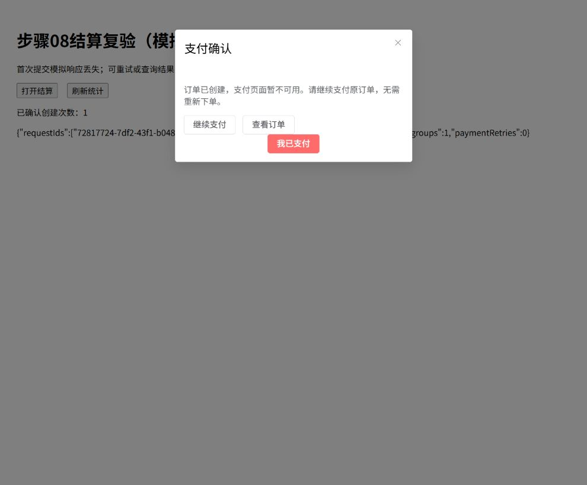

# 步骤08：下单幂等、SKU合并与库存回归

日期：2026-11-08（Asia/Shanghai）。本步实现下单请求一致性与库存事务，不把支付回调、退款和渠道关单竞态提前宣称完成。

**2026-11-12 补测更新。**本文件和 `08-results.json` 保留初次步骤08的本地验收记录。后续已修复 `postOrder` 缓存边界和前端旧响应兼容，并补入部分支付通知和金额核对代码。沙箱恢复后，一笔 ¥35.90 的真实沙箱付款补测通过，`order_request` 为 `CREATED`，支付单号、金额和归属与主订单一致，主订单已发货。 [支付改动复盘与补测证据](08-payment-change-audit.md)

## 改了什么，为什么需要

| 原行为/问题 | 本次改动 | 避免的问题 |
|---|---|---|
| 一次点击重试没有服务端请求标识 | 必填requestId，按userId+requestId唯一记录请求摘要和固定payOrderId | 双击、网络重试、响应丢失导致重复订单或重复占库存 |
| 为避免批量库存歧义，旧版直接拒绝重复SKU | 服务端按productId+SKU标识合并、排序；合并后最多99件；不同备注明确拒绝 | 同一SKU分多行时数量/金额计算错误，或丢失备注 |
| 批量库存JOIN遇到同SKU多条输入可能只应用其中一条 | SQL先GROUP BY/SUM，再条件更新；服务层构造独立变更列表并核对影响SKU行数 | 少扣/少退库存、负库存、修改内存订单明细为负数量 |
| 下单事务中请求支付、通知Redis | 事务只做订单/明细/物流/购物车、库存、幂等结果和可靠事件；Redis通知及支付链接生成在提交后 | 外部服务慢时长期占锁；链接失败使用户重新创建订单 |
| 再次付款会换payOrderId，只取一个订单金额 | 固定复用原支付号，按本人整个支付组求和 | 购物车一组订单被拆号，部分金额与支付业务号不匹配 |
| 重复取消先读状态，且库存归还未检查结果 | 锁定本人支付组，WAIT_PAYMENT条件更新，归还库存核对行数，同事务提交取消事件 | 并发重复返库存，或已取消却没有完整退库存 |
| 主动取消也统一写CLOSED(5) | 主动取消为CANCELLED(4)，超时关闭为CLOSED(5) | 页面与业务状态含义混淆 |
| 购物车批量删除依赖多条分号SQL | 使用一条按productId、SKU哈希、userId三元组匹配的SQL | 未开启allowMultiQueries时多商品结算失败，误操作其他用户购物车 |

地址归属、SKU归属、商品上架状态、库存和价格都以数据库为准。价格必须为正且符合金额精度；订单金额限制与现有DECIMAL(10,2)字段一致，没有扩大原表字段。商品与属性使用结构化组合键，避免直接字符串拼接产生标识碰撞。

## 一次购买请求如何工作

1. 前端根据当前账号、地址、支付方式、购买来源、合并后的商品数量与备注计算购买内容摘要；一次结算生成随机requestId。
2. 网络失败后保留原requestId；sessionStorage保存摘要与编号，不保存请求原文。存储受限时，当前页面仍通过内存复用。
3. 请求内容改变才生成新编号。用户明确重新打开结算，且上一次已确认创建后，才开始新的购买意图。
4. 后端以短事务预留order_request和固定支付号。相同用户/key且摘要不同会拒绝；已CREATED直接恢复原结果；尚在PROCESSING返回处理中。
5. 当前持有者在有超时的数据库事务中锁定请求行，创建订单、扣库存、写可靠事件，并把请求改为CREATED。所有业务写入一起回滚；请求预留记录保留为RETRY，供原请求恢复。
6. 事务提交后生成支付链接。链接失败返回CREATED+UNAVAILABLE及原业务号，前端显示“订单已创建，支付页面暂不可用”，提供继续支付入口。

PROCESSING租约默认120秒，配置项为 `checkout.request-lease-seconds`（允许3—300秒，短值用于隔离测试）。业务事务最长20秒，且小于配置的租约长度。崩溃后原请求可在自然到期后接管，支付号不变；旧事务仍持锁时，接管使用NOWAIT返回处理中，不并行创建订单。已持有资格的创建者使用有超时的普通行锁，等待并发唯一键检查短暂结束，避免所有并发请求都因NOWAIT返回处理中。

恢复仍由用户查询/重试原购买请求触发，不会仅凭后台摘要自动发起新的购买。相同内容但明确使用另一个requestId表示另一次购买；本步不声称跨账号、跨设备或所有独立标签页会自动共用编号。

## 接口与页面

- `POST /order/postOrder`：原JSON新增必填 `requestId`，格式为16—64位ASCII字母/数字/下划线/短横线；推荐UUID。
- `POST /order/getOrderRequest`：参数requestId，只查当前登录用户，不创建订单、不请求支付渠道。
- `POST /order/getPayInfo`：仍传原orderId，服务端复用整个支付组的原payOrderId和总金额。
- 响应保留payInfo/payOrderId/amount，并新增requestId、requestStatus、paymentStatus、orderId。
- requestStatus：PROCESSING（处理中）、CREATED（订单已创建）、RETRY（本轮未完成，可用原请求重试）。**CREATED不是支付成功**。
- paymentStatus：READY（可打开支付页）、UNAVAILABLE（订单已创建、链接暂不可用）、NOT_PAYABLE（当前状态或时间不允许付款）。

示例请求（替换为本人有效地址和已上架SKU）：

```json
{
  "requestId": "c788d7e0-939d-418a-9b48-647032415e19",
  "payMethod": "alipay_pc",
  "addressId": "YOUR_ADDRESS_ID",
  "orderFrom": 0,
  "orderList": [
    {"productId": "YOUR_PRODUCT_ID", "propertyValueIds": "YOUR_SKU_VALUE_IDS", "buyCount": 2, "remark": ""},
    {"productId": "YOUR_PRODUCT_ID", "propertyValueIds": "YOUR_SKU_VALUE_IDS", "buyCount": 3, "remark": ""}
  ]
}
```

以上会合并为同SKU共5件；重试必须保留requestId和购买内容。客户端显示价格仅供预览，最终金额取数据库价格。

## 数据库SQL：开发库需要执行什么

本轮**只在隔离MySQL 8.4.9、127.0.0.1:13306/easymall_test执行**。没有连接或修改日常开发库。

需要新增 **1张表order_request**，现有order_info/order_item/product_sku不新增字段。前置为11A的business_task表；若尚未建表，先执行 [V20261107_01__business_task.sql](../../db/migration/V20261107_01__business_task.sql)。两份脚本均不随应用启动自动执行；提交SQL文件也不会修改数据库。

先在数据库工具中选中商城实际使用的库，检查：

```sql
SELECT DATABASE(), VERSION();
SHOW TABLES LIKE 'business_task';
SHOW TABLES LIKE 'order_request';
```

确认MySQL 8.0.16+、InnoDB，order_request不存在后，打开并整段执行 [V20261107_02__order_request.sql](../../db/migration/V20261107_02__order_request.sql)。对应建表SQL如下，表结构与迁移文件一致：

```sql
CREATE TABLE order_request (
    user_id VARCHAR(15) COLLATE utf8mb4_bin NOT NULL,
    request_id VARCHAR(64) CHARACTER SET ascii COLLATE ascii_bin NOT NULL,
    request_hash CHAR(64) CHARACTER SET ascii COLLATE ascii_bin NOT NULL,
    status VARCHAR(16) CHARACTER SET ascii COLLATE ascii_bin NOT NULL,
    pay_order_id VARCHAR(32) CHARACTER SET ascii COLLATE ascii_bin NOT NULL,
    amount DECIMAL(12,2) NULL,
    lease_owner CHAR(32) CHARACTER SET ascii COLLATE ascii_bin NULL,
    lease_until DATETIME(6) NULL,
    last_error VARCHAR(32) CHARACTER SET ascii COLLATE ascii_bin NULL,
    created_at DATETIME(6) NOT NULL,
    updated_at DATETIME(6) NOT NULL,
    PRIMARY KEY (user_id, request_id),
    UNIQUE KEY uk_order_request_pay (pay_order_id),
    KEY idx_order_request_recovery (status, lease_until),
    CONSTRAINT chk_order_request_status CHECK (status IN ('PROCESSING','CREATED','RETRY')),
    CONSTRAINT chk_order_request_lease CHECK (
        (status='PROCESSING' AND lease_owner IS NOT NULL AND lease_until IS NOT NULL)
        OR (status<>'PROCESSING' AND lease_owner IS NULL AND lease_until IS NULL)
    ),
    CONSTRAINT chk_order_request_amount CHECK (status<>'CREATED' OR (amount IS NOT NULL AND amount>0))
) ENGINE=InnoDB DEFAULT CHARSET=utf8mb4 COLLATE=utf8mb4_bin
COMMENT='步骤08下单请求幂等记录';
```

上方为便于复制省略字段COMMENT的等价DDL，迁移文件保留字段说明。已有同名表时先 `SHOW CREATE TABLE order_request` 核对，不删除重建。DDL隐式提交；回退应用时保留表和请求记录。部署顺序为迁移 → 同步升级前后端 → 验证下单。旧前端缺少requestId会被拒绝，不提供随机补号来绕过幂等。

内部排查可按请求编号查询状态和支付号；不把leaseOwner、请求摘要或任务payload直接公开给客户端。

## 与11A和Redis的关系

下单事务写入ORDER_CREATED，取消事务写入ORDER_CANCELLED；唯一事件键防止重投。它们保存业务ID，不包含收货信息、备注或支付凭据。

本步这些事件尚未注册真实Worker处理器，会保留READY等待11B接入；**事件READY不代表订单仍在PROCESSING**，订单创建结果看order_request。没有给新Worker增加订单关闭消费者，旧Redis超时消费者仍是当前关闭执行路径，不发生两套关闭逻辑同时执行。

旧Redis超时通知移到提交后，截止时间固定为原订单时间加有效期，重复请求不会向后延长。Redis通知失败只记固定错误码，已提交的订单保持可查；创建事件仍在数据库中，但后台自动补偿/真实任务迁移尚属11B待办。聊天Topic和会话撤销Topic未改动。

渠道关闭已移出取消数据库事务，失败会留下固定日志及持久化取消事件。真实渠道“已付款但关闭/回调迟到”的处理仍需步骤10及11B补偿；不能把本步Mock证据当成支付沙箱或资金正确性验收。

## 测试案例和复现

后端根目录执行，仅需隔离MySQL，Redis/ES/模型不需要启动：

```powershell
docker compose -p easymall-baseline --env-file ../runtime/phase0/baseline.env -f compose.baseline.yml start mysql
./scripts/verify-checkout.ps1 -JavaHome '<JDK21目录>'
# 已缓存依赖时可加-Offline；Maven不在PATH时可加-MavenCommand '<mvn.cmd完整路径>'
```

脚本要求本轮5份报告更新且零跳过；集成必须显式启用，普通test/package不连接MySQL。测试保留所有合成商品、地址、购物车、订单及请求记录，不清库、不删除文件。测试辅助类、崩溃入口均位于src/test/java并明确标注测试专用。

| 场景 | 实际断言 |
|---|---|
| 库存5，8个并发购买 | 成功数量恰好5，库存0，订单明细合计5，无超卖 |
| 相同SKU 2件+3件 | 1条明细、数量5、金额61.70、库存扣5，原DTO数量不被改为负数 |
| 同requestId 8线程提交 | 1个支付业务号、1组订单、1次扣库存、1条创建事件 |
| 同key不同内容/跨用户查询 | 拒绝不同内容；不能查询别人的请求 |
| 事件写入中途失败 | 订单、明细、物流、库存一起回滚；同请求恢复仍使用预留支付号 |
| 8线程重复取消 | 库存仅归还一次，取消事件和渠道关闭调用各一次 |
| SKU库存行不匹配 | 取消状态与事件回滚，不出现只取消不归还库存 |
| 支付链接失败后重试 | 订单保留CREATED，使用原支付号，渠道调用不在活动事务中 |
| 多商品继续付款 | 原支付组金额合计37.02，不换支付号、不关闭旧支付号 |
| 多商品购物车结算 | 仅删除当前用户选中行，其他用户同SKU购物车保留 |
| PROCESSING查询 | 查询不启动另一组订单，也不调用支付渠道 |
| 真实进程提交前硬退出 | 预留记录存在，订单未提交；自然租约到期后以原支付号恢复 |
| 真实进程提交后、响应前硬退出 | 原订单和事件已提交；重试不再建单或扣库存 |

请求规范化单元测试6项、既有输入/权限回归44项、真实MySQL集成16项，共66项定向验证；44项中下单输入26、DTO校验11、资源归属7。最后两项新增集成分别验证购物车用户隔离和退库存失败时取消回滚。

前端在easymall-front-web目录运行 `npm run test:checkout`：12项，包括稳定编号、刷新恢复、内容变更、账号隔离、双击保护、PROCESSING、只读查询、继续原订单支付、弹窗拦截和旧支付状态清理。完整用户端测试与构建、后端package数量见 [08-results.json](08-results.json)。

浏览器使用 `tests/browser-checkout-server.mjs` 独立模拟接口复验：首次响应丢失，第二次提交编号一致，界面统计groups=1；订单创建后支付链接不可用提示正常，继续支付仅调用原订单支付接口，paymentRetries=1。弹窗内容写入与拦截由组件测试覆盖；本次内置浏览器没有暴露模拟新窗口，不宣称完成真实支付页面或渠道验证。



## 范围与后续

步骤08的下单/库存验收完成后再推进09。退款CAS、退款单、支付通知验签、付款与关单竞态、真实任务消费者和旧Redis存量迁移分别保留在09、10、11B。本轮未调用真实支付、模型或索引服务。

前端首次默认构建触发了dist旧产物清理，已逐文件恢复32个受影响的已跟踪构建产物，源码未受影响；新增构建文件保留，未进行批量清理。最终构建使用Vite API明确设置 `emptyOutDir: false`，输出到工作区 `runtime/phase2-step08-web-build`，不把dist变更混入源代码交付。后续验证构建也应使用独立输出目录并关闭清理。

参考：[MySQL行锁与NOWAIT](https://dev.mysql.com/doc/refman/8.4/en/innodb-locking-reads.html)、[Spring TransactionTemplate](https://docs.spring.io/spring-framework/reference/data-access/transaction/programmatic.html)。依赖版本沿用当前工程，未升级框架。
